<div align="center">

<!-- ================================================================= -->
<!-- 🎀 HERO / OPENING SCREEN                                         -->
<!-- ================================================================= -->

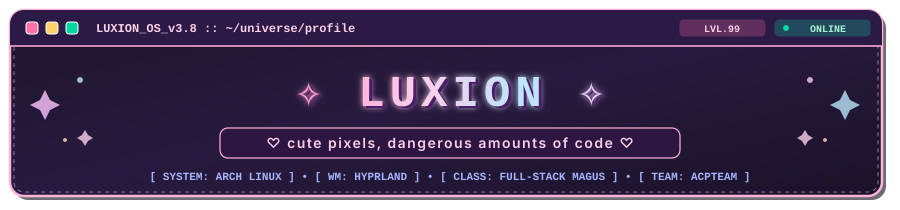

<br/><br/>

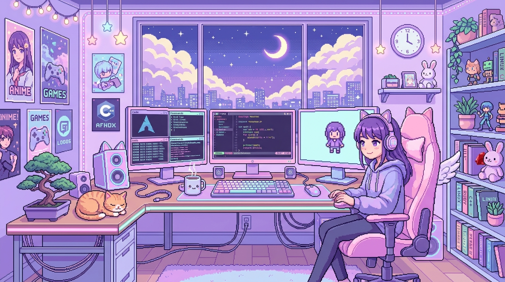

<br/><br/>

<a href="#01--character-profile">
  
</a>
&nbsp;
<a href="#02--rpg-skill-tree">
  
</a>
&nbsp;
<a href="#03--quest-board--builds">
  
</a>
&nbsp;
<a href="#04--battlestation-architecture">
  
</a>
&nbsp;
<a href="#07--tavern--contact">
  
</a>

<br/><br/>

<table>
  <tr>
    <td width="220" align="center" style="border: 2px solid #FFB7D5; border-radius: 14px; background: #1b102b; padding: 12px;">
      <br/>
      <sub style="color: #FFB7D5; font-family: monospace; font-weight: bold;">ฅ^•ﻌ•^ฅ Mochi :: Familiar Lv.42</sub>
    </td>
    <td style="border: 2px solid #DCC6FF; border-radius: 14px; background: #160e24; padding: 20px; vertical-align: middle;">
      <h3 style="margin-top: 0; color: #FFB7D5; font-family: 'Courier New', monospace;">
        ✧ Hello, traveler! Welcome to my digital sanctuary ✧
      </h3>
      <p style="color: #F1F5F9; font-size: 14.5px; line-height: 1.6;">
        I'm <b>Luxion</b> — a full-stack engineer, systems enthusiast, and student technical leader. I architect rock-solid web applications, craft fluid cyber-kawaii user interfaces, explore low-level Linux and audio pipelines in <b>Rust</b>, and train local-first AI models with GPU acceleration.
      </p>
      <p style="color: #D8B4FE; font-size: 13.5px; margin-bottom: 0;">
        <i>"Building with deep technical rigor, shipping with unwavering purpose, and decorating every commit with tiny sparkles."</i> ♡
      </p>
    </td>
  </tr>
</table>

<br/>


</div>

<!-- ================================================================= -->
<!-- 🎀 SECTION 01: CHARACTER PROFILE                                  -->
<!-- ================================================================= -->

<br/>

<div id="01--character-profile" align="center">
  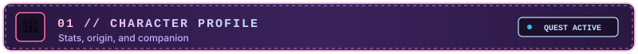
</div>

<br/>

<div align="center">
  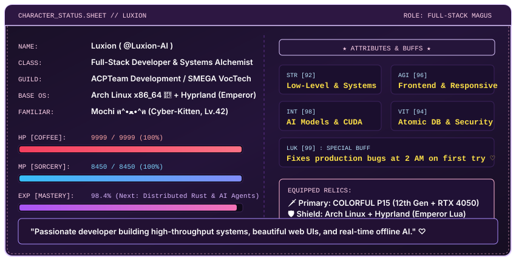
</div>

<br/>

### 📜 Character Lore & Background

```typescript
interface CharacterProfile {
  name: "Luxion";
  classRole: "Full-Stack Magus & Systems Alchemist";
  guilds: ["ACPTeam Development", "SMEGA VocTech"];
  alignment: "Chaotic Cute / Lawful Structured Code";
  environment: "Arch Linux x86_64 󰣇 • Hyprland (Emperor Lua)";
  currentQuest: "Engineering ZETA V1 (Offline Rust Audio AI Assistant)";
  passions: [
    "Full-Stack Web Architectures (React 19, Next.js, Node.js)",
    "Hardened Databases & Atomic Concurrency (PostgreSQL FOR UPDATE)",
    "Low-Level Systems & GPU Compute (Rust, C++, CUDA, ONNX)",
    "Desktop Compositing & Theming (Wayland, Lua, Quickshell)",
    "Zero-Bloat Engineering & Thoughtful Human Experiences"
  ];
  philosophy: "Cute UI, bulletproof architecture, zero excuses ♡";
}
```

* **The Craft**: Turning ambitious ideas into high-throughput, battle-tested software. Whether optimizing PostgreSQL row-locks for school-wide e-voting elections, engineering enterprise archival platforms according to national standards, or fine-tuning real-time audio DSP buffers in Rust.
* **The Environment**: A relentless tinkerer on Arch Linux with a completely bespoke, keyboard-centric Hyprland compositor setup orchestrated via custom Lua scripts.
* **The Spark**: Coding deep into the night fueled by black coffee, matcha latte, synthwave lo-fi, and an unquenchable curiosity to understand how every byte works down to the kernel.

<br/>

<div align="center">
  
</div>

<!-- ================================================================= -->
<!-- ⚡ SECTION 02: RPG SKILL TREE                                     -->
<!-- ================================================================= -->

<br/>

<div id="02--rpg-skill-tree" align="center">
  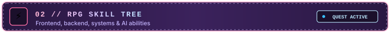
</div>

<br/>

<div align="center">
  <p style="color: #D8B4FE; font-size: 14px;">
    <i>Tiered proficiencies organized by domain. Real tools applied in active production codebases.</i>
  </p>
</div>

<table>
  <tr>
    <td width="50%" valign="top" style="border: 1px solid #FFB7D5; background: #180f26; border-radius: 10px; padding: 16px;">
      <h4 style="color: #FFB7D5; margin-top: 0;">🎀 Tier I: Frontend Enchantments</h4>
      <p></p>
      <ul style="color: #E2E8F0; font-size: 13px; line-height: 1.6;">
        <li><b>React 19 & Next.js 15+</b>: App Router, Server Components, Streaming, Turbopack.</li>
        <li><b>TypeScript & Modern ES</b>: Strict typing, generics, robust frontend error boundaries.</li>
        <li><b>Styling & UX</b>: Tailwind CSS 4, CSS variables, responsive mobile-first interfaces.</li>
        <li><b>Tooling</b>: Vite, Vitest unit testing, automated asset pipelines.</li>
      </ul>
    </td>
    <td width="50%" valign="top" style="border: 1px solid #DCC6FF; background: #180f26; border-radius: 10px; padding: 16px;">
      <h4 style="color: #DCC6FF; margin-top: 0;">⚙️ Tier II: Backend & Systems Sorcery</h4>
      <p></p>
      <ul style="color: #E2E8F0; font-size: 13px; line-height: 1.6;">
        <li><b>Node.js & Express</b>: Clean layered architectures, JWT HTTP-only cookies, rate limiters.</li>
        <li><b>Rust & Systems</b>: Safe concurrent memory management, ALSA audio, zero-overhead runtimes.</li>
        <li><b>PHP & Laravel</b>: MVC design patterns, Eloquent ORM relationships, API routing.</li>
        <li><b>C++ & Embedded</b>: Performance-critical algorithms, hardware interfacing experiments.</li>
      </ul>
    </td>
  </tr>
  <tr>
    <td width="50%" valign="top" style="border: 1px solid #BDE0FE; background: #180f26; border-radius: 10px; padding: 16px;">
      <h4 style="color: #BDE0FE; margin-top: 0;">🗄️ Tier III: Database & Storage Grimoires</h4>
      <p></p>
      <ul style="color: #E2E8F0; font-size: 13px; line-height: 1.6;">
        <li><b>PostgreSQL 16+</b>: Atomic row-level locking (<code>FOR UPDATE</code>), indexing, query optimization.</li>
        <li><b>Prisma ORM</b>: Declarative schema modeling, automatic migration governance, type-safe queries.</li>
        <li><b>MySQL & SQLite</b>: High-speed embedded state, self-hosted relational databases.</li>
        <li><b>Integrity Assurance</b>: Foreign key constraints, anti-race condition transaction boundaries.</li>
      </ul>
    </td>
    <td width="50%" valign="top" style="border: 1px solid #A7F3D0; background: #180f26; border-radius: 10px; padding: 16px;">
      <h4 style="color: #A7F3D0; margin-top: 0;">🐧 Tier IV: Linux, DevOps & Security</h4>
      <p></p>
      <ul style="color: #E2E8F0; font-size: 13px; line-height: 1.6;">
        <li><b>Arch Linux & Hyprland</b>: Custom kernel tuning, Wayland compositing, systemd management.</li>
        <li><b>Docker & Compose</b>: Isolated multi-service stacks, zero-downtime customer release tarballs.</li>
        <li><b>Defensive Bash</b>: Automated release scripts, checksum SHA256 integrity verifiers.</li>
        <li><b>AppSec Hardening</b>: Helmet security headers, bcrypt 10-salt hashing, sanitization.</li>
      </ul>
    </td>
  </tr>
  <tr>
    <td width="50%" valign="top" style="border: 1px solid #FED7AA; background: #180f26; border-radius: 10px; padding: 16px;">
      <h4 style="color: #FED7AA; margin-top: 0;">🤖 Tier V: AI & Local Inference Laboratory</h4>
      <p></p>
      <ul style="color: #E2E8F0; font-size: 13px; line-height: 1.6;">
        <li><b>ONNX Runtime & CUDA</b>: Direct GPU-accelerated tensor inference on RTX 4050.</li>
        <li><b>Local Voice AI</b>: Offline speech-to-text (Whisper) & neural TTS with sub-millisecond buffers.</li>
        <li><b>LLM Agent Workflows</b>: Multi-provider AI cascades, prompt optimization, offline assistants.</li>
        <li><b>Python Analytics</b>: Data science simulations, AI Studio integrations, model benchmarking.</li>
      </ul>
    </td>
    <td width="50%" valign="top" style="border: 1px solid #FBCFE8; background: #180f26; border-radius: 10px; padding: 16px;">
      <h4 style="color: #FBCFE8; margin-top: 0;">🎮 Tier VI: Creative Coding & Desktop Theming</h4>
      <p></p>
      <ul style="color: #E2E8F0; font-size: 13px; line-height: 1.6;">
        <li><b>Lua & Quickshell (QML)</b>: Custom Wayland UI components, reactive status bars, Matugen themes.</li>
        <li><b>Neovim & Kitty</b>: Custom modal keybinding ecosystems, GPU-accelerated terminal environments.</li>
        <li><b>Visual Design</b>: Scalable vector graphics (SVG), 16-bit retro pixel art, typography.</li>
        <li><b>Creative Coding</b>: Interactive browser mechanics, audio DSP visualizers, experimental UI.</li>
      </ul>
    </td>
  </tr>
</table>

<br/>

<div align="center">
  
</div>

<!-- ================================================================= -->
<!-- ⚔️ SECTION 03: QUEST BOARD & BUILDS                              -->
<!-- ================================================================= -->

<br/>

<div id="03--quest-board--builds" align="center">
  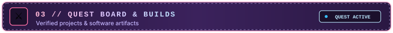
</div>

<br/>

<div align="center">
  <p style="color: #D8B4FE; font-size: 14px;">
    <i>Selected authentic software artifacts engineered with genuine passion and verified repositories.</i>
  </p>
</div>

<!-- QUEST 1: ZETA V1 -->
<table width="100%">
  <tr>
    <td width="65" align="center" valign="middle" style="background: #25133d; border-radius: 10px; border: 1px solid #A855F7;">
      <span style="font-size: 32px;">🤖</span>
    </td>
    <td style="background: #180f29; border-radius: 10px; border: 1px solid #A855F7; padding: 16px;">
      <div style="float: right;">
        
        
      </div>
      <h3 style="margin: 0; color: #FBCFE8; font-family: monospace;">ZETA V1 — Real-Time Local-First Desktop AI Assistant</h3>
      <p style="color: #E2E8F0; font-size: 13.5px; margin: 8px 0 10px 0;">
        A production-grade, local-first native desktop AI assistant built completely from scratch in <b>Rust</b>. Runs entirely offline on Linux with <b>NVIDIA RTX 4050 GPU acceleration (CUDA + ONNX Runtime)</b>, zero Python runtime dependencies, and sub-millisecond real-time audio safety for Indonesian and English voice interactions.
      </p>
      <code style="background: #0f081c; padding: 3px 8px; border-radius: 5px; color: #BAE6FD;">Rust</code>
      <code style="background: #0f081c; padding: 3px 8px; border-radius: 5px; color: #BAE6FD;">CUDA</code>
      <code style="background: #0f081c; padding: 3px 8px; border-radius: 5px; color: #BAE6FD;">ONNX Runtime</code>
      <code style="background: #0f081c; padding: 3px 8px; border-radius: 5px; color: #BAE6FD;">ALSA Audio DSP</code>
      <code style="background: #0f081c; padding: 3px 8px; border-radius: 5px; color: #BAE6FD;">Arch Linux</code>
    </td>
  </tr>
</table>

<br/>

<!-- QUEST 2: EMPEROR HYPRLAND -->
<table width="100%">
  <tr>
    <td width="65" align="center" valign="middle" style="background: #25133d; border-radius: 10px; border: 1px solid #38BDF8;">
      <span style="font-size: 32px;">👑</span>
    </td>
    <td style="background: #180f29; border-radius: 10px; border: 1px solid #38BDF8; padding: 16px;">
      <div style="float: right;">
        <a href="https://github.com/Luxion-AI/Emperor-Hyprland">
          
        </a>
      </div>
      <h3 style="margin: 0; color: #BAE6FD; font-family: monospace;">Emperor-Hyprland — Modular Wayland Desktop Environment</h3>
      <p style="color: #E2E8F0; font-size: 13.5px; margin: 8px 0 10px 0;">
        A complete, elegant Wayland desktop ecosystem for Arch Linux. Features modular <b>Lua-based Hyprland orchestration</b>, Quickshell and Walker integration, Waybar with 9 custom themes, Matugen dynamic Material You color matching, 11 animation profiles, and fine-tuned NVIDIA GPU environment flags.
      </p>
      <code style="background: #0f081c; padding: 3px 8px; border-radius: 5px; color: #FFB7D5;">Lua</code>
      <code style="background: #0f081c; padding: 3px 8px; border-radius: 5px; color: #FFB7D5;">Hyprland</code>
      <code style="background: #0f081c; padding: 3px 8px; border-radius: 5px; color: #FFB7D5;">Quickshell (QML)</code>
      <code style="background: #0f081c; padding: 3px 8px; border-radius: 5px; color: #FFB7D5;">Waybar</code>
      <code style="background: #0f081c; padding: 3px 8px; border-radius: 5px; color: #FFB7D5;">Matugen</code>
      <code style="background: #0f081c; padding: 3px 8px; border-radius: 5px; color: #FFB7D5;">Shell</code>
    </td>
  </tr>
</table>

<br/>

<!-- QUEST 3: ZEVERION SCHOOL -->
<table width="100%">
  <tr>
    <td width="65" align="center" valign="middle" style="background: #25133d; border-radius: 10px; border: 1px solid #34D399;">
      <span style="font-size: 32px;">🏛️</span>
    </td>
    <td style="background: #180f29; border-radius: 10px; border: 1px solid #34D399; padding: 16px;">
      <div style="float: right;">
        <a href="https://github.com/Luxion-AI/Zeverion-Example">
          
        </a>
      </div>
      <h3 style="margin: 0; color: #A7F3D0; font-family: monospace;">Zeverion School Ecosystem — Hardened Full-Stack Platform</h3>
      <p style="color: #E2E8F0; font-size: 13.5px; margin: 8px 0 10px 0;">
        A production-grade educational ecosystem featuring a <b>React & Vite</b> frontend, <b>TypeScript</b> backend, <b>PostgreSQL</b> database, and fully automated Docker Compose deployment. Implements bcrypt 10-round password hashing, HTTP-only cookie JWTs, IP rate-limiting, and automated SHA-256 integrity release testing.
      </p>
      <code style="background: #0f081c; padding: 3px 8px; border-radius: 5px; color: #FDE047;">React</code>
      <code style="background: #0f081c; padding: 3px 8px; border-radius: 5px; color: #FDE047;">Vite</code>
      <code style="background: #0f081c; padding: 3px 8px; border-radius: 5px; color: #FDE047;">TypeScript</code>
      <code style="background: #0f081c; padding: 3px 8px; border-radius: 5px; color: #FDE047;">PostgreSQL</code>
      <code style="background: #0f081c; padding: 3px 8px; border-radius: 5px; color: #FDE047;">Docker Compose</code>
    </td>
  </tr>
</table>

<br/>

<!-- QUEST 4: PRIMA SECRETA -->
<table width="100%">
  <tr>
    <td width="65" align="center" valign="middle" style="background: #25133d; border-radius: 10px; border: 1px solid #F472B6;">
      <span style="font-size: 32px;">📜</span>
    </td>
    <td style="background: #180f29; border-radius: 10px; border: 1px solid #F472B6; padding: 16px;">
      <div style="float: right;">
        
      </div>
      <h3 style="margin: 0; color: #FBCFE8; font-family: monospace;">PRIMA SECRETA — Modern Archival & Correspondence Management</h3>
      <p style="color: #E2E8F0; font-size: 13.5px; margin: 8px 0 10px 0;">
        Modern web-based digital archiving and office automation platform for educational institutions. Complies with 5 national ANRI classification standards (Alphabetical, Dewey, Chronological, Subject, Geographic) with interactive cabinet visualization, automated agenda books, and cryptographic document authenticity checks.
      </p>
      <code style="background: #0f081c; padding: 3px 8px; border-radius: 5px; color: #D8B4FE;">Next.js</code>
      <code style="background: #0f081c; padding: 3px 8px; border-radius: 5px; color: #D8B4FE;">TypeScript</code>
      <code style="background: #0f081c; padding: 3px 8px; border-radius: 5px; color: #D8B4FE;">Prisma ORM</code>
      <code style="background: #0f081c; padding: 3px 8px; border-radius: 5px; color: #D8B4FE;">PostgreSQL</code>
      <code style="background: #0f081c; padding: 3px 8px; border-radius: 5px; color: #D8B4FE;">Tailwind CSS</code>
    </td>
  </tr>
</table>

<br/>

<!-- QUEST 5: E-VOTING SMEGA -->
<table width="100%">
  <tr>
    <td width="65" align="center" valign="middle" style="background: #25133d; border-radius: 10px; border: 1px solid #FDE047;">
      <span style="font-size: 32px;">🗳️</span>
    </td>
    <td style="background: #180f29; border-radius: 10px; border: 1px solid #FDE047; padding: 16px;">
      <div style="float: right;">
        
      </div>
      <h3 style="margin: 0; color: #FEF08A; font-family: monospace;">E-Voting SMEGA — High-Integrity Atomic Election Portal</h3>
      <p style="color: #E2E8F0; font-size: 13.5px; margin: 8px 0 10px 0;">
        Real-time election platform designed for 1,475 eligible voters and 28 class stands across 4 major departments. Built with strict PostgreSQL atomic transactions and row-locking (<code>FOR UPDATE</code>) to guarantee strictly one vote per student with instant zero-race-condition live administrative tallies.
      </p>
      <code style="background: #0f081c; padding: 3px 8px; border-radius: 5px; color: #67E8F9;">Node.js</code>
      <code style="background: #0f081c; padding: 3px 8px; border-radius: 5px; color: #67E8F9;">Express</code>
      <code style="background: #0f081c; padding: 3px 8px; border-radius: 5px; color: #67E8F9;">PostgreSQL Concurrency</code>
      <code style="background: #0f081c; padding: 3px 8px; border-radius: 5px; color: #67E8F9;">Real-Time Dashboard</code>
    </td>
  </tr>
</table>

<br/>

<!-- QUEST 6: OSSAGA -->
<table width="100%">
  <tr>
    <td width="65" align="center" valign="middle" style="background: #25133d; border-radius: 10px; border: 1px solid #FB7185;">
      <span style="font-size: 32px;">🌸</span>
    </td>
    <td style="background: #180f29; border-radius: 10px; border: 1px solid #FB7185; padding: 16px;">
      <div style="float: right;">
        <a href="https://github.com/Luxion-AI/OSSAGA">
          
        </a>
      </div>
      <h3 style="margin: 0; color: #FECDD3; font-family: monospace;">OSSAGA — Modern Laravel Web Application</h3>
      <p style="color: #E2E8F0; font-size: 13.5px; margin: 8px 0 10px 0;">
        A structured web application built on the Laravel framework. Demonstrates clean MVC separation of concerns, Blade view composition, Eloquent ORM relations, and modern PHP service orchestration.
      </p>
      <code style="background: #0f081c; padding: 3px 8px; border-radius: 5px; color: #A7F3D0;">PHP</code>
      <code style="background: #0f081c; padding: 3px 8px; border-radius: 5px; color: #A7F3D0;">Laravel</code>
      <code style="background: #0f081c; padding: 3px 8px; border-radius: 5px; color: #A7F3D0;">Blade</code>
      <code style="background: #0f081c; padding: 3px 8px; border-radius: 5px; color: #A7F3D0;">MySQL</code>
    </td>
  </tr>
</table>

<br/>

<div align="center">
  
</div>

<!-- ================================================================= -->
<!-- 🖥️ SECTION 04: DEVELOPER WORKSTATION                             -->
<!-- ================================================================= -->

<br/>

<div id="04--battlestation-architecture" align="center">
  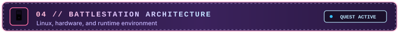
</div>

<br/>

<div align="center">
  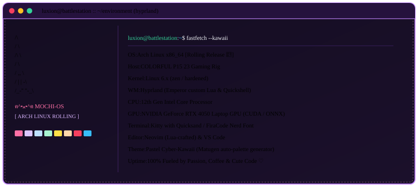
</div>

<br/>

```ini
[RUNTIME_SPECIFICATION]
Hardware    = "COLORFUL P15 23 Gaming Chassis"
CPU         = "12th Gen Intel(R) Core(TM) Processor"
GPU         = "NVIDIA GeForce RTX 4050 Laptop GPU (CUDA & Tensor Acceleration)"
OperatingSys= "Arch Linux (Rolling Release, Zen/Hardened Kernel)"
Compositor  = "Hyprland Wayland Compositor (Orchestrated by Emperor Lua)"
AudioStack  = "Low-Latency ALSA & PipeWire with Real-Time DSP Buffers"
Terminal    = "Kitty Terminal with Quicksand & FiraCode Nerd Font"
Editor      = "Neovim (Lua-crafted modal setup) & VS Code"
PaletteGen  = "Matugen Dynamic Color Extraction (Auto-Themed Pastel Cyber)"
```

* 🚀 **Arch Linux Hardening**: Stripped-down rolling system with minimal background daemons, maximized memory throughput, and direct access to GPU compute headers.
* ⌨️ **Keyboard-Driven Workflow**: High-efficiency window tiling via Hyprland bindings, customized Waybar modules, and instant fuzz-finding through Rofi/Walker.
* 🎧 **Low-Latency Audio**: Custom ALSA hardware configuration tuned for sub-millisecond audio capture, voice activity detection (VAD), and neural synthesis.

<br/>

<div align="center">
  
</div>

<!-- ================================================================= -->
<!-- 🌷 SECTION 05: GITHUB ACTIVITY & DATA GARDEN                     -->
<!-- ================================================================= -->

<br/>

<div id="05--github-data-garden" align="center">
  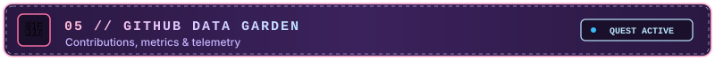
</div>

<br/>

<div align="center">

<!-- GitHub Stats & Top Languages -->
<a href="https://github.com/Luxion-AI">
  
</a>
&nbsp;
<a href="https://github.com/Luxion-AI">
  
</a>

<br/><br/>

<!-- Streak Stats -->
<a href="https://github.com/Luxion-AI">
  
</a>

<br/><br/>

<!-- Contribution Activity Graph -->


<p style="color: #BAE6FD; font-size: 13px;">
  <i>🌷 Every commit is a digital blossom planted in the software garden. 🌷</i>
</p>

</div>

<br/>

<div align="center">
  
</div>

<!-- ================================================================= -->
<!-- 📜 SECTION 06: CODING PHILOSOPHY                                  -->
<!-- ================================================================= -->

<br/>

<div id="06--coding-philosophy" align="center">
  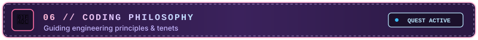
</div>

<br/>

<div align="center">
  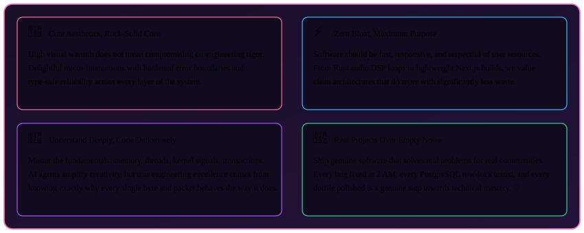
</div>

<br/>

1. **Cute UI, Bulletproof Core**: Delightful aesthetics and rigorous systems engineering are complementary virtues. An interface should feel welcoming and responsive, supported by unshakeable type safety and graceful error recovery.
2. **Zero Bloat, High Purpose**: Value every CPU cycle, frame render, and megabyte of RAM. From high-speed Rust DSP loops to clean Next.js builds, avoid unnecessary abstractions.
3. **Deep Mechanical Sympathy**: Master the machine rather than blindly pasting boilerplate. Understand operating system signals, memory layouts, database transaction locks, and GPU pipelines.
4. **Real Software Over Empty Noise**: True technical capability is demonstrated by shipped code, solved bottlenecks, and dependable systems that genuinely empower people.

<br/>

<div align="center">
  
</div>

<!-- ================================================================= -->
<!-- 💌 SECTION 07: TAVERN & CONTACT                                  -->
<!-- ================================================================= -->

<br/>

<div id="07--tavern--contact" align="center">
  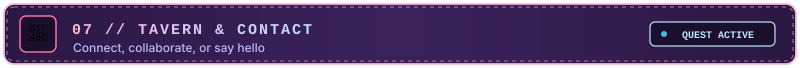
</div>

<br/>

<div align="center">


<br/><br/>

<h3 style="color: #FFB7D5; font-family: 'Courier New', monospace;">
  ✧ GAME SAVED! READY FOR THE NEXT CO-OP QUEST ✧
</h3>

<p style="color: #F1F5F9; font-size: 14.5px; max-width: 680px; line-height: 1.6;">
  Whether you have an intriguing systems problem, want to collaborate on high-performance open-source tools, talk about Arch Linux dotfiles, or discuss local AI architectures — my tavern doors are always open!
</p>

<br/>

<a href="https://github.com/Luxion-AI">
  
</a>
&nbsp;
<a href="mailto:acpluxion@gmail.com">
  
</a>
&nbsp;
<a href="https://github.com/Luxion-AI/Emperor-Hyprland">
  
</a>

<br/><br/>

<p style="color: #D8B4FE; font-size: 13px;">
  <b>Crafted with ♡, countless cups of coffee, and authentic pixel passion by Luxion.</b><br/>
  <sub>Arch Linux x86_64 • Hyprland • Rust • TypeScript • 2026</sub>
</p>

<p style="color: #FFB7D5; font-size: 14px;">
  <i>じゃあね！ Keep coding, stay curious, and always make the internet a cuter place! ฅ(˶> ᵕ <˶)ฅ ♡🎀</i>
</p>

</div>
